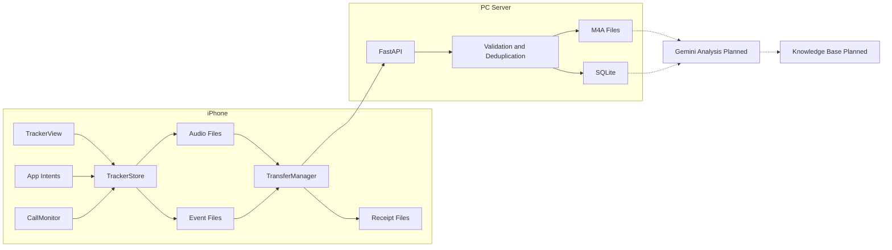

# Life Tracker implementation map

This map is maintained manually. Source code remains authoritative. The Swift
implementation is not yet compiled or device-tested. Server ingestion has local
integration tests. Analysis and knowledge-base writing are planned boundaries,
not implemented workers.

| Environment | Screen or entry | Logic | Storage |
| --- | --- | --- | --- |
| iPhone | `TrackerView`, Shortcuts App Intents | `TrackerStore`: audio segmentation, location log filtering, message capture; `CallMonitor`: observed call state | Application Support/LifeTracker: audio, event JSON, receipt JSON; token in Keychain |
| iPhone | PC synchronization action | `TransferManager`: Wi-Fi only background file uploads; verifies server receipts | Files retained after receipt; failed tasks can be rescheduled |
| PC | `/api/v1/events`, `/api/v1/audio` | Bearer authentication, validation, checksum, idempotency | SQLite and M4A in external runtime directory |
| Agent (planned) | Audio file or Gemini web workflow | Interpretation review, then optional record writing | Existing knowledge-base/event and periodic/daily |

## Code entry points

- iOS screen: `ios/LifeTracker/LifeTrackerApp.swift`
- Shortcut interface: `ios/LifeTracker/Intents.swift`
- Audio, GPS, event files: `ios/LifeTracker/TrackerStore.swift`
- Upload and acknowledgment: `ios/LifeTracker/TransferManager.swift`
- Call state: `ios/LifeTracker/CallMonitor.swift`
- PC API and schema: `server/life_tracker/app.py`
- Server integration tests: `server/tests/test_ingestion.py`

A node comment is ordinary information unless explicitly addressed to an agent
(e.g. `@agent`). No comment dispatcher or automatic agent execution exists yet.

## Code Flow Lens view

With the existing Code Flow Lens dev server running, open:
`http://localhost:5174/?map=life-tracker`

`docs/code-flow-map.json` is the manually authored map. A copy is deployed to
Code Flow Lens `web/public/generated/life-tracker.json`. Its viewer now accepts
an optional `?map=NAME` parameter; omitting it preserves the ETF sample. Changes
to this source map must be recopied explicitly; there is no automatic analyzer
or synchronization. Browser comments do not invoke an agent yet, including
comments containing `@agent`.
